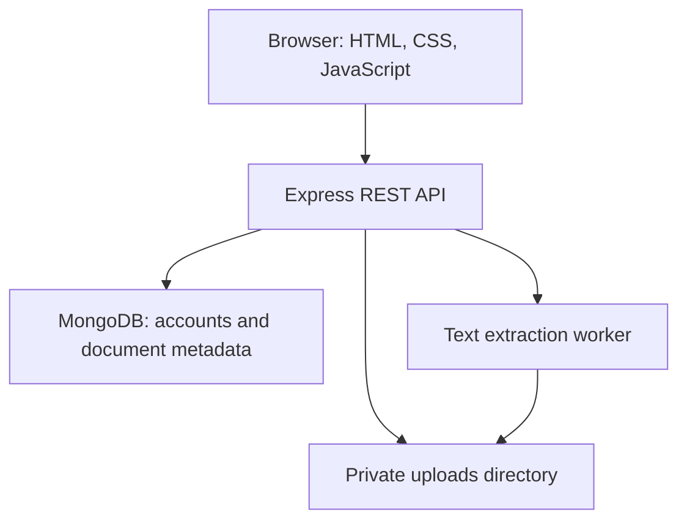
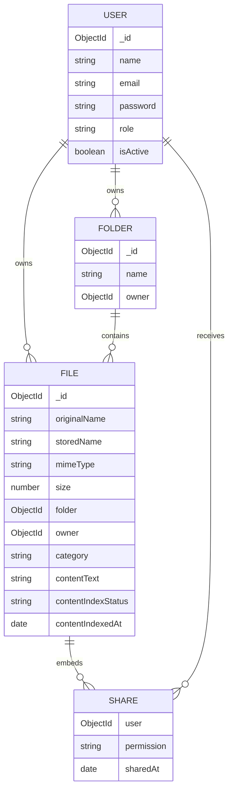
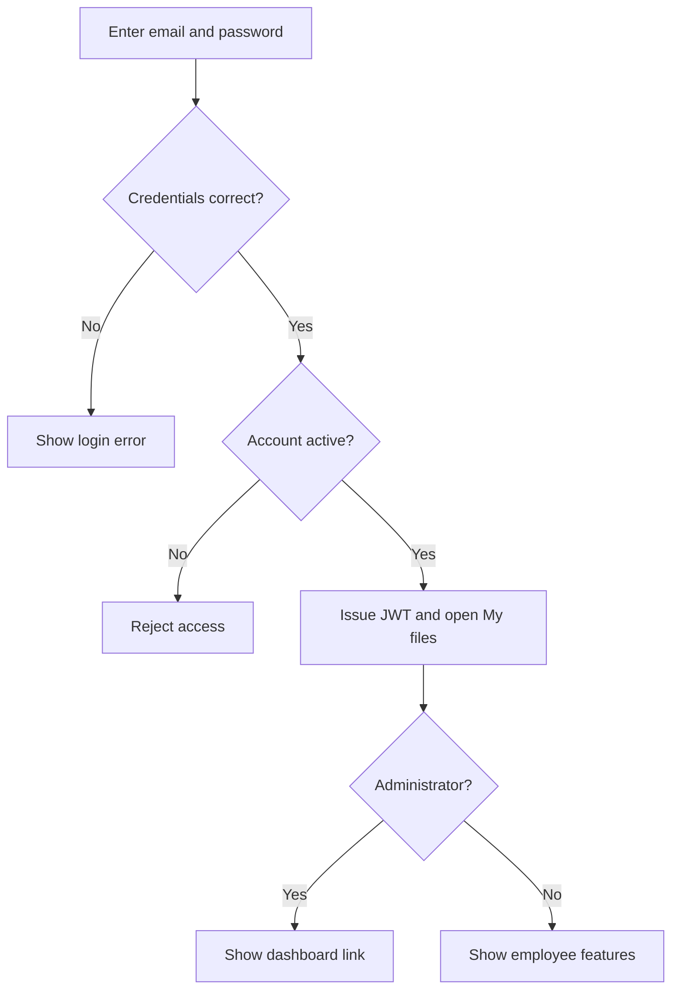
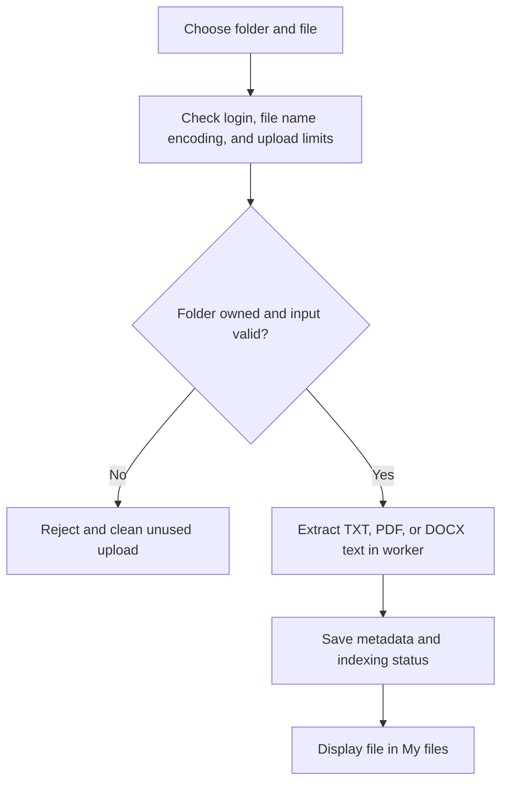
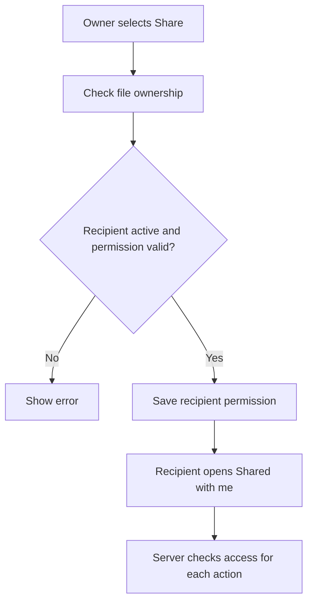

# System Design | تصميم النظام

## English

### 1. Project Purpose

ECM helps employees store, organize, search, and share digital documents. Administrators can manage employee account status and view system statistics.

### 2. System Requirements

| Requirement | Implementation |
| --- | --- |
| User accounts | Employee and administrator roles |
| Authentication | Email and password login with JWT |
| Folder management | Create, rename, and delete empty owned folders |
| File management | Upload, download, categorize, and delete owned files |
| Search | File names and supported content, ignoring letter case and whitespace |
| Content extraction | TXT, Word DOCX, and text-based PDF |
| Search filters | Folder and category |
| File names | Arabic file name correction for new uploads |
| Sharing | Share with registered active users and revoke access |
| Permissions | Owner, view recipient, and edit recipient |
| Administration | Statistics and employee activation controls |
| Interface | Arabic, English, light/dark themes, and mobile layouts |

### 3. Users and Permissions

| User | Permissions |
| --- | --- |
| Employee | Manage personal files and folders |
| File owner | Download, categorize, share, and delete the owned file |
| View recipient | Download the shared file |
| Edit recipient | Download and change the shared file category |
| Administrator | Employee features, system statistics, and employee account controls |

Only the owner can manage sharing or delete a file. Administrator status does not automatically grant access to other users' documents.

### 4. System Architecture

The browser displays the interface. The API validates requests and checks permissions. MongoDB stores records, while the uploads directory stores document bytes.

The worker extracts TXT text using TextDecoder, PDF text using pdf-parse, and DOCX text using Mammoth. Extracted text and indexing status are saved with the file record.

### 5. Database Design

SHARE represents entries embedded in the File document's `sharedWith` array. It is not a separate collection.

The password field stores a hash. User, Folder, and File records also have creation and update timestamps. Extracted content is excluded from ordinary file query results.

The original display name is separate from the generated storage name.

### 6. Login Workflow

Protected API requests check the token and current database account. Administrator routes also check the user's role.

### 7. Upload and Search Workflow

#### Upload

If text extraction fails, an otherwise valid upload can still be saved and found by file name.

New uploads attempt to correct UTF-8 file names received as Latin-1. Previously stored incorrect names are not automatically repaired.

#### Search

- Search is restricted to the signed-in user's owned files.
- Users can search file names, extracted content, or both.
- The query is normalized using NFKC.
- Query whitespace is removed, and matching allows whitespace between characters.
- Letter case is ignored.
- Regular expression symbols in the query are treated literally.
- Category and folder filters can narrow the results.
- Category filtering remains an exact, case-insensitive match.

For example, `Week 22`, `week22`, and `WeEk   22` match the same text.

Older DOCX files previously marked as unsupported may need reindexing before content search can find them.

### 8. Sharing Workflow

The owner can update or remove sharing. Revoking access prevents future authorized downloads but does not remove previously downloaded copies.

The search controls in My files do not search the shared-files list.

### 9. Interface Design

| Screen | Main elements |
| --- | --- |
| Login | Email, password, visibility toggle, language, and theme |
| My files | Folders, upload form, search filters, and file actions |
| Sharing dialog | Recipient email, permission, and current shares |
| Shared with me | Shared documents and permitted actions |
| Admin dashboard | Statistics and employee activation controls |

Forms stack vertically on smaller screens. File tables support horizontal scrolling. Arabic uses right-to-left layout.

The search help text describes DOCX support, case-insensitive matching, whitespace handling, and the extraction limit in both languages.

### 10. Design Limits

- Upload size is limited to 10 MB per file.
- Content search supports owned TXT, DOCX, and text-based PDF files.
- The older Word `.doc` format is not supported.
- Searchable extracted content is limited to 500,000 characters per file.
- Text extraction has a 20-second timeout.
- The worker has a 256 MB old-generation JavaScript heap limit; this is not a limit on all process memory.
- Edit permission changes categories, not document contents.
- OCR, password recovery, and malware scanning are not included.
- Previously stored incorrect file names require separate correction.
- File-system operations and database operations are not one transaction.
- Search performance on large datasets has not been established.

---

## العربية

### 1. هدف المشروع

يساعد ECM الموظفين على حفظ المستندات الرقمية وتنظيمها والبحث عنها ومشاركتها. يستطيع المسؤول إدارة حالة حسابات الموظفين وعرض إحصائيات النظام.

### 2. متطلبات النظام

| المتطلب | التنفيذ |
| --- | --- |
| حسابات المستخدمين | دور موظف ودور مسؤول |
| المصادقة | الدخول بالبريد وكلمة المرور باستخدام JWT |
| إدارة المجلدات | إنشاء المجلدات المملوكة وتغيير أسمائها وحذف الفارغ منها |
| إدارة الملفات | رفع الملفات المملوكة وتنزيلها وتصنيفها وحذفها |
| البحث | الاسم والمحتوى المدعوم مع تجاهل حجم الحروف والمسافات |
| استخراج المحتوى | TXT وWord بصيغة DOCX وPDF النصي |
| فلاتر البحث | المجلد والتصنيف |
| أسماء الملفات | تصحيح أسماء الملفات العربية عند الرفع الجديد |
| المشاركة | المشاركة مع مستخدم مسجّل ونشط وإلغاء وصوله |
| الصلاحيات | مالك ومستلم بصلاحية عرض أو تعديل |
| الإدارة | الإحصائيات وتفعيل حسابات الموظفين وتعطيلها |
| الواجهة | العربية والإنجليزية والمظهر الفاتح والداكن ودعم الجوال |

### 3. المستخدمون والصلاحيات

| المستخدم | الصلاحيات |
| --- | --- |
| الموظف | إدارة ملفاته ومجلداته الشخصية |
| مالك الملف | تنزيل ملفه وتصنيفه ومشاركته وحذفه |
| مستلم بصلاحية عرض | تنزيل الملف المشارَك |
| مستلم بصلاحية تعديل | تنزيل الملف وتغيير تصنيفه |
| المسؤول | وظائف الموظف والإحصائيات وإدارة حالة حسابات الموظفين |

المالك وحده يدير المشاركة ويحذف الملف. دور المسؤول لا يمنح تلقائيًا الوصول إلى مستندات الآخرين.

### 4. بنية النظام

مخطط البنية في القسم الإنجليزي يوضح:

- المتصفح يعرض الواجهة باستخدام HTML وCSS وJavaScript.
- Express يستقبل الطلبات ويتحقق من البيانات والصلاحيات.
- MongoDB تحفظ الحسابات والمجلدات وبيانات الملفات والمشاركة.
- مجلد `uploads` يحفظ المستندات خارج مجلد الواجهة العامة.
- عامل منفصل يستخرج النص من المستندات المدعومة.

يستخدم العامل TextDecoder لملفات TXT، ومكتبة pdf-parse لملفات PDF، ومكتبة Mammoth لملفات DOCX. يُحفظ النص المستخرج وحالة الفهرسة مع سجل الملف.

### 5. تصميم قاعدة البيانات

مخطط العلاقات في القسم الإنجليزي يوضح ثلاثة نماذج رئيسية:

| النموذج | البيانات الرئيسية |
| --- | --- |
| User | الاسم والبريد وهاش كلمة المرور والدور وحالة الحساب |
| Folder | اسم المجلد ومرجع المالك |
| File | الاسم والحجم والنوع والمالك والمجلد والتصنيف والمشاركة والنص المستخرج |

العلاقات:

- المستخدم يستطيع امتلاك عدة مجلدات وملفات.
- المجلد يستطيع احتواء عدة ملفات.
- الملف يستطيع احتواء عدة مشاركات.
- كل مشاركة تربط المستخدم بصلاحيته وتاريخ المشاركة.

المشاركات محفوظة داخل مصفوفة `sharedWith` في سجل الملف، وليست مجموعة مستقلة.

تحتوي النماذج الرئيسية أيضًا على تاريخ الإنشاء والتعديل. يُستبعد النص المستخرج من نتائج الاستعلامات العادية.

الاسم الأصلي المعروض منفصل عن اسم التخزين المولّد.

### 6. سير تسجيل الدخول

1. يدخل المستخدم البريد وكلمة المرور.
2. يتحقق السيرفر من صحة البيانات.
3. يتحقق من نشاط الحساب.
4. يصدر JWT عند نجاح الدخول.
5. تفتح صفحة ملفاتي.
6. يظهر رابط لوحة المسؤول للحساب الذي يملك دور المسؤول.

الطلبات المحمية تتحقق من التوكن والحساب الحالي في قاعدة البيانات. مسارات المسؤول تتحقق من الدور أيضًا.

### 7. سير الرفع والبحث

#### رفع الملف

1. يختار المستخدم المجلد والملف.
2. يتحقق السيرفر من الدخول وترميز الاسم وحدود الرفع.
3. يتحقق من ملكية المجلد وصحة البيانات.
4. يستخرج العامل النص من TXT أو PDF أو DOCX إذا كان مدعومًا.
5. تُحفظ بيانات الملف وحالة الفهرسة.
6. يظهر الملف في صفحة ملفاتي.

إذا فشل استخراج النص، يمكن حفظ الملف الصالح والبحث عنه باسمه.

يحاول الرفع الجديد تصحيح أسماء UTF-8 المستقبلة بترميز Latin-1. لا تُصلح الأسماء القديمة المخزّنة تلقائيًا.

#### البحث

- البحث محصور في الملفات المملوكة للمستخدم المسجّل دخوله.
- يمكن البحث باسم الملف أو النص المستخرج أو كليهما.
- يُوحّد الاستعلام باستخدام NFKC.
- تُحذف مسافات الاستعلام، وتسمح المطابقة بوجود مسافات بين الأحرف.
- يُتجاهل حجم الحروف.
- تُعامل رموز التعبيرات النمطية في الاستعلام كنص حرفي.
- يمكن تضييق النتائج بفلاتر التصنيف والمجلد.
- يبقى فلتر التصنيف مطابقًا تمامًا مع تجاهل حجم الحروف.

مثلًا، تطابق `Week 22` و`week22` و`WeEk   22` النص نفسه.

قد تحتاج ملفات DOCX القديمة المسجّلة سابقًا كغير مدعومة إلى إعادة الفهرسة قبل البحث داخلها.

### 8. سير المشاركة

1. يضغط المالك مشاركة.
2. يتحقق السيرفر من ملكية الملف.
3. يتحقق من نشاط المستلم وصحة الصلاحية.
4. تُحفظ المشاركة.
5. يظهر الملف لدى المستلم في قسم تمت مشاركتها معي.
6. يتحقق السيرفر من الوصول عند تنفيذ الإجراءات.

يستطيع المالك تغيير الصلاحية أو إلغاء المشاركة. إلغاء الوصول لا يحذف النسخ التي سبق تنزيلها.

خيارات البحث في ملفاتي لا تبحث في قائمة الملفات المشتركة مع المستخدم.

### 9. تصميم الواجهات

| الشاشة | العناصر الرئيسية |
| --- | --- |
| الدخول | البريد وكلمة المرور وإظهارها واللغة والمظهر |
| ملفاتي | المجلدات والرفع والبحث وإجراءات الملفات |
| نافذة المشاركة | بريد المستلم والصلاحية وقائمة المشاركات |
| تمت مشاركتها معي | المستندات المشارَكة والإجراءات المسموحة |
| لوحة المسؤول | الإحصائيات والتحكم بحالة حسابات الموظفين |

تُرتّب حقول النماذج عموديًا على الشاشات الصغيرة. تدعم جداول الملفات التمرير الأفقي، وتستخدم العربية اتجاهًا من اليمين إلى اليسار.

يوضح وصف البحث دعم DOCX وتجاهل حجم الحروف والمسافات وحد الاستخراج باللغتين.

### 10. حدود التصميم

- الحد الأقصى للرفع 10 MB لكل ملف.
- البحث بالمحتوى يدعم ملفات TXT وDOCX وPDF النصية المملوكة للمستخدم.
- صيغة Word القديمة `.doc` غير مدعومة.
- الحد الأقصى للنص القابل للبحث 500,000 حرف مستخرج لكل ملف.
- مهلة استخراج النص 20 ثانية.
- حد ذاكرة JavaScript من نوع old generation للعامل 256 MB، وليس حدًا لجميع ذاكرة العملية.
- التعديل يغيّر التصنيف وليس محتوى المستند.
- لا يوجد OCR أو استعادة كلمة المرور أو فحص للبرمجيات الضارة.
- الأسماء القديمة غير الصحيحة تحتاج تصحيحًا منفصلًا.
- عمليات الملفات وقاعدة البيانات ليست معاملة واحدة.
- لم يُثبت أداء البحث على مجموعات بيانات كبيرة.